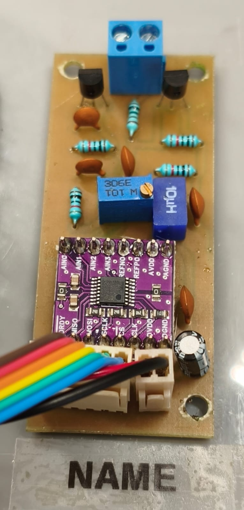

# NAME — Nanoampere Meter for Electrophoresis

**NAME** is an open-source hardware project for measuring electrophoretic current in capillary electrophoresis (CE) systems. It is intended especially for CE instruments that do not include their own current-measurement system.

NAME is an independent project designed to complement **[Zones](https://github.com/claudimir-lago/Zones)**. NAME provides the electrophoretic current signal, while software such as Zones can use the recorded current for further data treatment, including charge-domain analysis.

> **Project status:** advanced working hardware. NAME has been built, tested, and implemented in four capillary electrophoresis instruments. Release **v1.0.0** provides the open hardware design, manufacturing files, firmware examples, bundled ADS1220 SoftSPI library, and initial technical documentation needed to reproduce and integrate NAME.

## Release

Current public release: **NAME v1.0.0** (2026-10-14).

This release includes the KiCad 10.0 source project, fabrication outputs, BOM, the assembled-board photograph, a PDF schematic, Arduino examples, the `ADS1220_WE_SoftSPI` library, and initial technical documentation.

## Project maturity

NAME is already operational hardware, not an early proof-of-concept. It has been implemented in four CE instruments. Version **1.0.0** is the first public release packaging the working design as a reproducible open-hardware project. See [`docs/project-status.md`](docs/project-status.md).

## Repository contents

- `hardware/kicad/` — editable KiCad 10.0 project files.
- `hardware/gerbers/` — KiCad-generated Gerber and drill fabrication outputs.
- `hardware/fabrication/` — bill of materials (BOM) and manufacturing notes.
- `firmware/libraries/ADS1220_WE_SoftSPI/` — bundled software-SPI ADS1220 library used by the reference implementation.
- `firmware/examples/` — minimal Arduino examples for blocking and non-blocking NAME acquisition.
- `docs/` — operating principle, connector pinout, installation, calibration, testing, and integration documentation.
- `examples/` — example electrophoretic-current data (to be added).
- `images/` — photographs, renderings, and diagrams, including the assembled board shown above and a PDF export of the electrical schematic.

## Hardware

The current design is maintained as a native **KiCad 10.0** project. Project-specific ADS1220 symbol and footprint libraries are included in the repository and are referenced relative to the project directory, so the project does not depend on the original developer's local file paths.

See [`hardware/kicad/README.md`](hardware/kicad/README.md) for details.

## NAME and Zones

NAME and Zones are intentionally separate projects. NAME is responsible for acquisition of the electrophoretic current signal, whereas Zones is data-analysis software.

Documentation will progressively describe recommended data formats and practical integration between the two projects. See [`docs/zones-integration.md`](docs/zones-integration.md).

Zones repository: https://github.com/claudimir-lago/Zones

## Documentation and characterization roadmap

The hardware is already in operational use. The following material will be added to improve reproducibility and provide systematic technical characterization:

- principle of operation (initial documentation included);
- measurement range, resolution, noise, offset, and systematic bandwidth characterization;
- calibration and zero/offset procedures (initial documentation included);
- assembly and first-test procedure;
- connector pinout and interfacing (initial documentation included);
- electrical safety considerations for CE systems (see [`docs/safety.md`](docs/safety.md));
- firmware and Arduino acquisition examples (initial examples are now included);
- validation and performance characterization;
- integration with Zones.

## Licenses

This repository uses separate licenses for software and hardware:

- **NAME-specific firmware, software, and code examples:** GNU General Public License v3.0 or later (`GPL-3.0-or-later`). See [`LICENSE`](LICENSE).
- **Hardware design files:** CERN Open Hardware Licence Version 2 — Strongly Reciprocal (`CERN-OHL-S-2.0`). See [`LICENSE-HARDWARE`](LICENSE-HARDWARE).
- **`ADS1220_WE_SoftSPI`:** MIT License, inherited from Wolfgang (Wolle) Ewald's original [`ADS1220_WE`](https://github.com/wollewald/ADS1220_WE) library. See the library-specific `LICENSE`.

Files may contain more specific licensing notices where appropriate.

## Citation

The [`CITATION.cff`](CITATION.cff) file contains the citation metadata for the **v1.0.0** release. GitHub can use this file to provide a ready-to-copy citation for the project.

## Contributing

Suggestions, test results, corrections, and improvements are welcome. See [`CONTRIBUTING.md`](CONTRIBUTING.md).

## Disclaimer

NAME is an open scientific-instrumentation project that has been implemented in working CE systems. Users are responsible for evaluating electrical safety and suitability for their own CE systems, especially where high voltages are present.

## Fabrication package status

The repository contains KiCad-generated Gerber, drill, and BOM files for the current **single-sided PCB design**. Copper routing is on `B.Cu` only; no `F.Cu` fabrication layer is required for this design. The corrected `Edge.Cuts` output contains only the board profile.

## Arduino integration

Two compact Arduino examples are included. The first shows the minimum blocking readout; the second extracts the interrupt-driven ADS1220 acquisition strategy used in the working [minimalistiCE](https://github.com/lab-laia/minimalistiCE) firmware.

Both examples use the bundled `ADS1220_WE_SoftSPI` library, a software-SPI adaptation of Wolfgang Ewald's `ADS1220_WE`. Software SPI allows NAME to be integrated using freely selected GPIO pins instead of requiring the microcontroller's default hardware SPI pins. The conversion used by the deployed minimalistiCE implementation is made explicit as `NAME_NA_PER_MV = 200.0f`. This factor follows directly from the 5 kOhm Thevenin resistance of R2 and R3. The ADS1220 measurement is differential, and RV1 provides a hardware zero adjustment. An additional calibration factor can be applied when higher absolute accuracy is required. See [`docs/principle-of-operation.md`](docs/principle-of-operation.md). The same document also describes the analog low-pass networks and the additional ADS1220 50/60 Hz digital filtering used in the reference firmware.

## Electrical connections

The current hardware exposes three connectors: J1 for the electrophoretic-current input and shield, J2 for 3–5 V power, and J3 for the ADS1220 digital interface (`DRDY`, `MISO`, `MOSI`, `SCLK`, and `CS`; the sixth `CLK` pin is currently unused). J1 is intended for connection to the **low-voltage electrode** of the CE system. See [`docs/interfacing.md`](docs/interfacing.md) for the complete pinout and minimal installation procedure.
